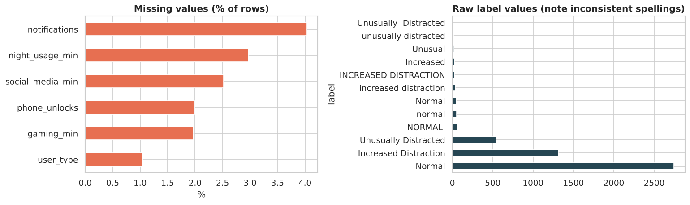
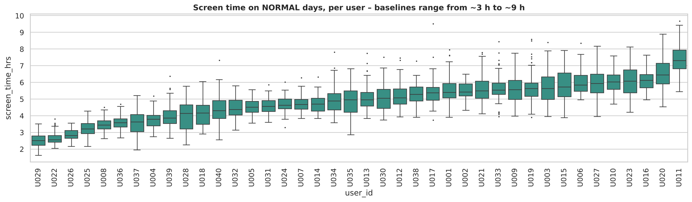
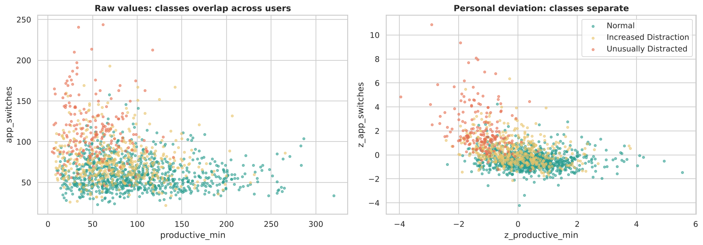
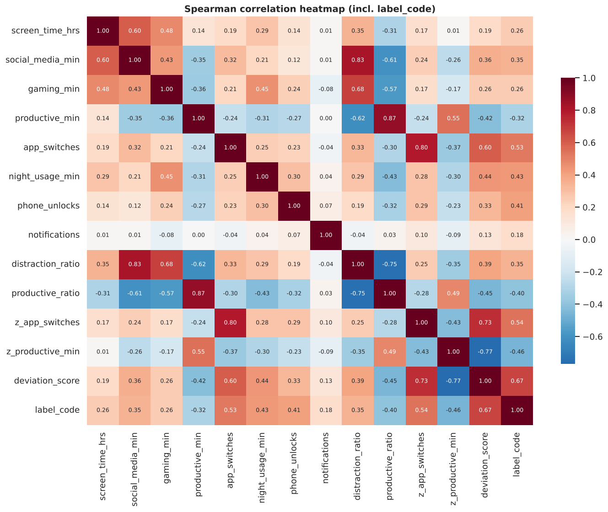
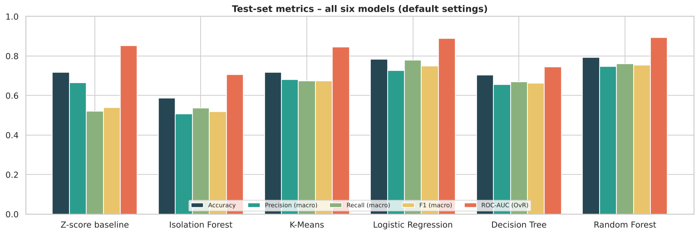
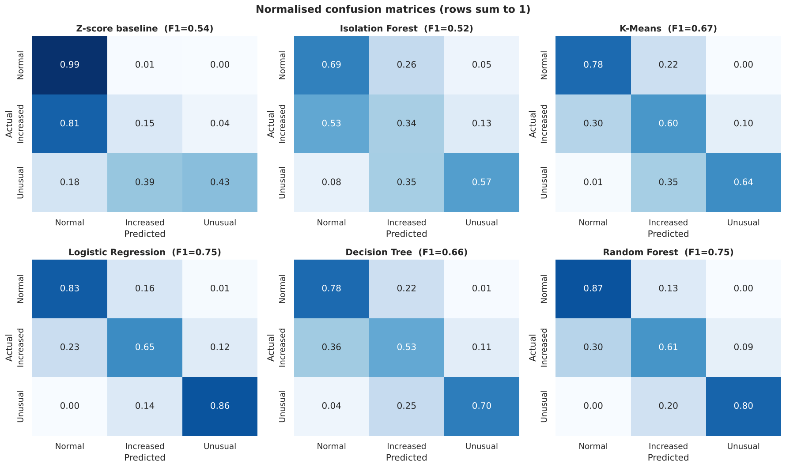
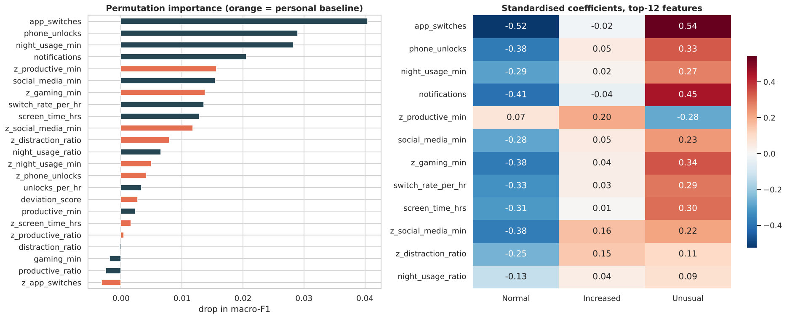

# Technical Report
## Predicting When a Person's Digital Activity Pattern Becomes Unusually Distracted

**Course:** AD23532 Principles of Data Science · B.Tech Artificial Intelligence and Data Science · Rajalakshmi Engineering College · Semester V, 2026-27 (ODD)

---

## 1. Problem statement and objectives (Review 1)

Seven hours of screen time can be a focused work day for one person and a lost day for another. The useful signal is **how a day differs from that person's own normal**: more social media and gaming, less productive time, far more app switching and more late-night use.

**Problem.** Given one day of a person's digital activity, classify it as *Normal*, *Increased Distraction* or *Unusually Distracted* relative to that person's baseline.

**Objectives.**
1. Build a personal baseline for each user from their own recent history.
2. Engineer deviation features (activity ratios and personal z-scores).
3. Train and compare statistical, unsupervised and supervised approaches.
4. Select the best model with quantitative evidence and deploy it in an interactive web app.

**Stakeholders.** Students, working professionals, digital-wellbeing app developers, mentors (aggregate trends only).

**Dataset.** Per-app logs with day-level labels are private, so a simulated dataset was generated (`src/generate_dataset.py`, seed 42): 40 users (22 students, 18 professionals) × 120 days (1 Jan – 29 Apr 2024). Each user has a personal baseline; each day follows a Markov chain over the three states (distraction persists; weekends raise its chance); 7% of labels are noisy. Columns: user, user type, date, screen time, social / gaming / productive / other minutes, app switches, night usage, unlocks, notifications, label. Realistic recording faults were injected (Section 2).

**Tools.** Python, pandas, NumPy, scikit-learn, SciPy, Matplotlib, Seaborn; HTML/JavaScript for the app; Git/GitHub. Runs on a laptop CPU in about five minutes.

---

## 2. Data quality and preprocessing (Review 2)

### 2.1 Issues found (raw file: 4,885 rows × 14 columns)

| Issue | Column | Rows |
|---|---|---|
| Missing values | user_type 51, social 123, gaming 96, night 145, unlocks 97, notifications 197 | 1–4% each |
| Exact duplicate records | all | 85 |
| Inconsistent label spellings | label | 290 |
| Inconsistent user_type spellings | user_type | 190 |
| Non-ISO dates (dd/mm/yyyy) | date | 242 |
| Total ≠ sum of activity minutes | screen_time_hrs | 21 |
| Negative durations | gaming_min | 13 |
| Screen time > 24 h | screen_time_hrs | 8 |
| Night usage > 360 min window | night_usage_min | 10 |
| Sensor overflow 9999 | app_switches | 14 |

### 2.2 Cleaning and justification
* **Standardise text** for labels and user types and **parse both date formats** — recovers rows instead of dropping them.
* **Remove duplicates** on the natural key (user + date): a person has one log per day.
* **Impossible values → missing**, not clipped — clipping 9999 would invent an extreme day.
* **Impute with the person's own median** — respects personal baselines and is robust to skew.
* **Recompute total screen time** from its parts so totals are consistent.
* **Keep genuine high values** — IQR outliers in social, gaming and night use are mostly real distracted days, the events the model must learn.

All validation checks pass: no missing values, one row per user per day (4,800 rows), valid categories, durations ≥ 0, screen time ≤ 24 h.

### 2.3 Transformation and feature engineering
* Encoding: `user_type` → `is_student`; label → ordinal 0/1/2; date → `day_of_week`, `is_weekend`.
* Ratios: distraction ratio, productive ratio, switches per hour, night-usage ratio, unlocks per hour.
* **Personal z-scores** for nine signals against the mean and standard deviation of the **previous 14 days** (shifted by one day, so no future information leaks), plus a composite *deviation score*. The first 7 days per user are a warm-up and are excluded (4,520 modelling rows).
* Feature selection: mutual information with the label; drop features with |r| > 0.9 to a stronger one or MI < 0.005 (`is_weekend`, `is_student`, `other_min` dropped). **23 features** remain.
* Scaling: `StandardScaler` inside each model pipeline, fitted on training data only.
* Integration: a user-profile table (40 rows) joined to the daily table on `user_id`; subsets for students/professionals and weekdays/weekends; a day-of-week reshape.

### 2.4 Key EDA findings

1. **Baselines differ widely** — normal-day screen time ranges from about 3 h to 9 h between people, so a single threshold cannot work.
2. **Raw values overlap across classes; personal z-scores separate them** (Kruskal-Wallis effect sizes and mutual information are highest for z-features).

3. **Classes are imbalanced** (≈60 / 29 / 12%) → macro-F1, balanced class weights, stratified views.
4. **Weekends raise the share of distracted days**, but the effect already appears in the usage values.
5. **Skewed, heavy-tailed distributions** and partly non-linear relationships → compare linear and tree-based models; use robust medians.

---

## 3. Model building and comparison (Review 3)

### 3.1 Models and justification
| Model | Type | Reason |
|---|---|---|
| Z-score rule (1σ/2σ) | statistical | transparent floor every model must beat |
| Isolation Forest | unsupervised anomaly detection | works without labels |
| K-Means (k = 3) | clustering | discovers natural day-types |
| Logistic Regression | linear probabilistic | calibrated, interpretable |
| Decision Tree | non-linear rules | readable, captures interactions |
| Random Forest | ensemble | low-variance non-linear model |

### 3.2 Validation design
* **Chronological hold-out:** train 8 Jan – 31 Mar (3,360 rows), test 1 – 29 Apr (1,160 rows) — always predicting future days.
* **GroupKFold (5 folds) by person** for cross-validation and tuning — each fold is scored on unseen people.

### 3.3 Results on the test month

| Model | Accuracy | Precision | Recall | Macro-F1 | F1 Unusual | ROC-AUC | CV F1 |
|---|---|---|---|---|---|---|---|
| Z-score baseline | 0.716 | 0.664 | 0.522 | 0.540 | 0.554 | 0.853 | – |
| Z-score baseline (tuned) | 0.754 | 0.689 | 0.637 | 0.650 | 0.667 | 0.855 | – |
| Isolation Forest | 0.588 | 0.507 | 0.536 | 0.518 | 0.510 | 0.705 | – |
| K-Means | 0.718 | 0.681 | 0.674 | 0.674 | 0.676 | 0.847 | – |
| Logistic Regression | 0.784 | 0.726 | 0.779 | 0.749 | 0.767 | 0.890 | 0.740 |
| Decision Tree | 0.704 | 0.657 | 0.669 | 0.662 | 0.692 | 0.746 | 0.622 |
| Random Forest | 0.794 | 0.748 | 0.760 | 0.754 | 0.780 | 0.895 | 0.760 |
| **Logistic Regression (tuned)** | **0.812** | **0.778** | 0.751 | **0.763** | **0.786** | **0.898** | 0.752 |
| Decision Tree (tuned) | 0.761 | 0.702 | 0.705 | 0.703 | 0.712 | 0.858 | 0.708 |
| Random Forest (tuned) | 0.793 | 0.738 | **0.765** | 0.750 | 0.762 | 0.893 | **0.763** |

K-Means clustering quality on test days (k = 3): Silhouette 0.283, Davies-Bouldin 1.247, Calinski-Harabasz 612; k = 2 has the best silhouette (0.47) because it separates normal from not-normal days, but the task has three ordered states.

### 3.4 Hyperparameter tuning
| Model | Best setting | Test F1 before → after |
|---|---|---|
| Logistic Regression | C = 0.03, no class weight | 0.749 → 0.763 |
| Decision Tree | depth / leaf size / criterion grid | 0.662 → 0.703 |
| Random Forest | max_depth 10, balanced weights | 0.754 → 0.750 |
| Z-score rule | thresholds 0.4σ / 1.4σ | 0.540 → 0.650 |

### 3.5 Ablation — does the personal baseline matter?
| Feature set | LR test F1 | RF test F1 |
|---|---|---|
| Raw usage only (11) | 0.694 | 0.742 |
| Raw + ratios (16) | 0.711 | 0.743 |
| Raw + ratios + personal z (23) | **0.763** | 0.750 |

### 3.6 Final model selection
**Tuned Logistic Regression.** It is best on 5 of 7 metrics. Against the runner-up Random Forest the difference is not statistically significant (test F1 +0.012, 95% bootstrap CI −0.015 to +0.042, McNemar p = 0.063; RF's CV F1 0.763 ± 0.032 vs LR 0.752 ± 0.014). With equal accuracy the simpler model is preferred: half the fold-to-fold spread across unseen people, calibrated probabilities, readable coefficients, and a 1.7 kB model that runs in the browser.

**Why it outperforms the others.**
* vs **Z-score rule:** learns a weight for each deviation instead of weighting all equally (+0.22 macro-F1 over the 1σ/2σ rule).
* vs **Isolation Forest / K-Means:** knows the *direction* of a change — an unusually productive day is anomalous but not distracted.
* vs **Decision Tree:** much lower variance.
* vs **Random Forest:** once a day is expressed as deviation from the person's own baseline, the boundary is close to linear; the ablation shows LR gains +0.069 F1 from those features while RF's extra flexibility adds variance rather than accuracy.

**Error analysis.** 18.8% of test days are misclassified; all but one error is between neighbouring classes (mostly Increased ↔ Normal), consistent with ~7% noisy self-reported labels. Only one Normal day was predicted as Unusual.

---

## 4. Product
The model and results are bundled into a single-page web app (`docs/index.html`): a live predictor (example people from the test month, or your own typical day vs today), with probability bars and a personal-baseline strip for each signal, plus the data-quality, EDA, model-comparison and final-model sections. The browser implementation is checked against the Python model on 15 test days (`models/parity_check.json`).

## 5. Limitations and future work
Simulated data (validate on real consented logs); 7-day warm-up before a baseline exists; self-reported labels. Next: sequence models over consecutive days, per-user threshold calibration, on-device inference for privacy.

## 6. Conclusion
Detecting distraction is a question of **change relative to oneself**, not of total hours. Personal-baseline features plus a tuned Logistic Regression detect Unusually Distracted days with F1 0.79 and ROC-AUC 0.90 on an unseen month, outperforming statistical, unsupervised and tree-based alternatives or matching them with a simpler, more interpretable model.
